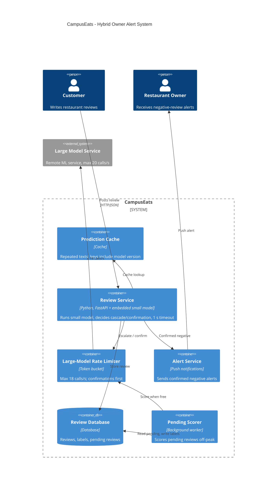

# Task 4: Deployment topologies and trade-offs

**Name: Natthakit Jirayuthanyawat**

**Student ID: 01326174**

This is **individual work**: each student completes and submits their own copy, in their own fork.

## Scenario: Owner alerts

When a customer posts a negative review, the restaurant owner gets a push notification within **2 seconds**. At the lunch peak, CampusEats receives **40 reviews per second**. A missed alert is acceptable, but a wrong alert (for example, "your customer is unhappy" when they are happy) makes owners stop trusting alerts and, in the end, ignore them.

## 1. Quality requirements

| # | Quality | Requirement |
|---|---|---|
| 1 | Accuracy | At least 95% of sent alerts must be for truly negative reviews (alert precision ≥ 95%), measured on a labeled review set. Missing an alert is preferable to sending a wrong one. |
| 2 | Performance | Send a confirmed negative-review push notification within 2 seconds. |
| 3 | Scalability | Handle 40 reviews per second at peak while keeping large-model demand within its maximum capacity of 20 calls per second. |

## 2. Design

**Chosen topology: T3 – Hybrid**, with cascade, cache, and rate limiting.

The small model runs locally inside the Review Service, while the large model confirms potential negative reviews before an owner notification is sent. Offline replay results show that confirmation requires 20.4 large-model calls per second with caching, slightly exceeding the 20-call-per-second capacity. A rate limiter in front of the large model caps demand at 18 calls per second and gives confirmations priority; overflow escalations are marked `pending` and scored later.

**Patterns used:**
- **Cascade:** Run the small model first and use the large model for reviews that need further checking (confidence < 0.6) and to confirm confident small-model negatives.
- **Cache:** Reuse predictions for repeated review text, while including the model version in the cache key so old predictions are not used after a model update.
- **Rate limiting:** All large-model calls pass through a limiter capped at 18 calls per second (2 calls/s below capacity). Confirmations of negative reviews get priority because they are time-critical. When the limit is reached, escalations for uncertain reviews are stored as `pending` and scored later (FR4); they do not trigger a late alert.
- **Fallback:** Each large-model call has a 1-second timeout, which leaves room inside the 2-second alert budget. If the large model fails, times out, or the limiter rejects a confirmation, do not send an unverified alert. A missed alert is preferable to a false alert in this scenario.

### C4 container diagram

## 3. Evidence

| Run | What it shows |
|---|---|
| `t0-large` | The large model reaches 93.5% accuracy, but has a p50 latency of 491 ms and requires a large-model call for every review. |
| `t0-small` | The small model is fast (23 ms p50) and uses no large-model calls, but its accuracy is only 72.5%. |
| `t2-0.6` | The cascade at threshold 0.6 reaches 91.5% accuracy, with 8 ms p50, 544 ms p95, and 38% large-model calls. |
| `t3-cache-0.6` | Cascade at 0.6 plus cache reaches 91.5% accuracy, with 7 ms p50, 508 ms p95, 31% large-model calls, and 36% cache hits. |
| `t1-after` | With the fallback and 10% of large-model calls hanging: 0 errors, 27 pending, p95 1007 ms (compared with 21 errors in `t1-before`). |

**Capacity calculation at 40 reviews per second:**

- **T1:** 40 × 100% = **40 large-model calls/second**, which exceeds the 20-call/second limit.
- **Cascade at 0.6:** 40 × 38% = **15.2 large-model calls/second**, which is below the limit.
- **Cascade plus cache at 31% (`t3-cache-0.6`):** 40 × 31% = **12.4 large-model calls/second**. This excludes confirmation calls, so it is not the demand of the chosen design; with confirmation the estimate rises to 20.4 calls/second (table below), which is why the rate limiter is needed.

The 31% figure is measured in `t3-cache-0.6`. It does not include the confirmation calls for confident small-model negatives. To measure those, the 200 load-test reviews were replayed offline at threshold 0.6:

| Measure (offline replay, 200 load-test reviews, threshold 0.6) | Share of reviews | Large-model calls/s at 40 reviews/s |
|---|---|---|
| Escalated (small-model confidence < 0.6) | 37.5% | 15.0 |
| Confident small-model negatives (need confirmation) | 36.0% | 14.4 |
| Total with confirmation, no cache | 73.5% | 29.4 |
| Total with confirmation and cache (each repeated text confirmed once) | 51.0% | 20.4 |

Of the 72 confident small-model negatives, 6 were actually positive reviews.

## 4. ADR

**Title:** Hybrid Deployment for CampusEats Owner Alerts

**Status:** Proposed

**Context:**

CampusEats receives 40 reviews per second at peak, but the large model can handle at most 20 calls per second. Owner alerts must arrive within 2 seconds. A missed alert is acceptable, but a false alert can cause owners to lose trust in the system. The small model is fast and inexpensive, but it can be confidently wrong, especially when reviews contain negations or contrast words.

**Decision:**

Use T3 (Hybrid), combining a local small model, remote large model, cascade, caching, and rate limiting. Require large-model confirmation before sending negative-review alerts. Since offline replay estimates 20.4 calls per second with caching, add a rate limiter that accepts at most 18 calls per second. Confirmations get priority over escalations because they are time-critical; when the limit is reached, escalations for uncertain reviews are stored as `pending` and scored later (FR4) without sending a late alert. If a confirmation is rejected by the limiter or exceeds its 1-second timeout, skip the alert rather than send an unverified notification.

**Consequences:**

- Positive:
  - Most reviews can be processed quickly by the local model.
  - Caching repeated review text can reduce inference work and cost.
  - Large-model confirmation reduces the risk of false owner alerts. In the replay, 6 of the 72 confident small-model negatives (8.3%) were actually positive reviews; without confirmation, each of these would have become a wrong alert, which is exactly the trust problem in the scenario.
  - Skipping uncertain alerts protects owner trust when the system cannot verify a result.

- Negative:
  - Large-model confirmation adds latency and cost. Offline replay estimates 29.4 calls per second without caching and 20.4 calls per second with caching, against a 20-call-per-second capacity.
  - The 18-call-per-second limit means some large-model requests cannot be served at peak. At estimated cached demand, approximately 2.4 requests per second exceed the limit; because confirmations have priority, these are escalations, which become `pending` and receive a label later instead of in real time.
  - Some genuinely negative reviews may not generate alerts if they are left `pending`, or if confirmation fails or misses its timeout.
  - The complete design still needs peak-load testing because the replay involved only 200 reviews, and alert precision with confirmation still needs to be measured against the 95% target.

**Alternatives considered:**

- **T1 – Model as a service, synchronous:** Rejected because sending all 40 reviews per second to the large model would exceed its 20-call-per-second capacity.
- **T2 – Model as a library:** Rejected as the only model because the small model's measured accuracy is 72.5%, and it can be confidently wrong. That creates too much risk if its negative predictions directly trigger owner alerts.
- **T4 – Asynchronous / batch:** Rejected as the primary topology because waiting to score reviews later could violate the 2-second notification requirement. It is used only as the overflow path for `pending` escalations.
